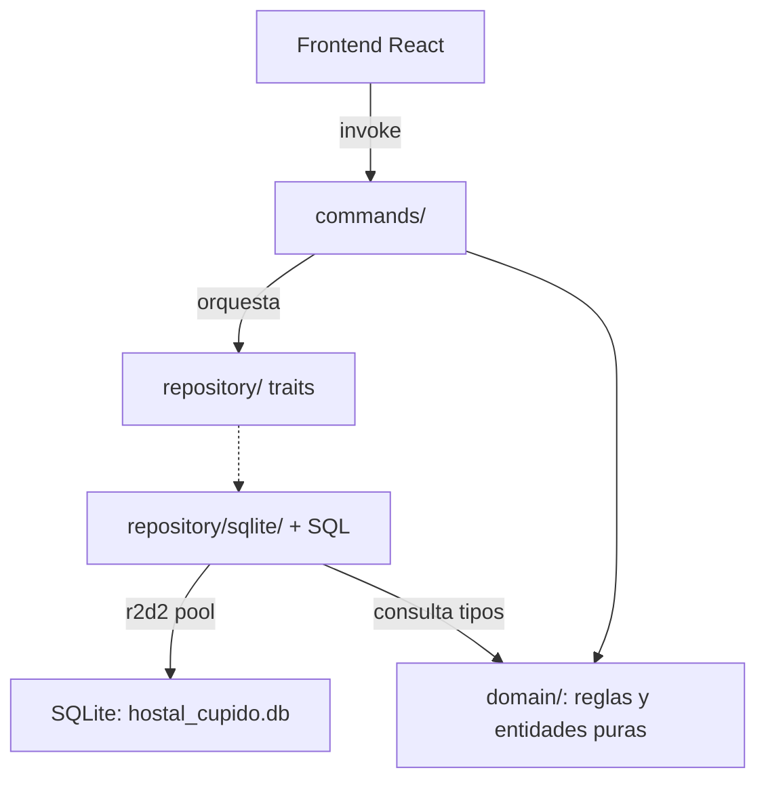

# Arquitectura — Hostal Cúpido

Aplicación de escritorio (Tauri v2) con frontend React + TypeScript y backend en Rust sobre SQLite local. El backend se organiza en capas con dependencias que apuntan hacia adentro: la lógica de negocio vive en `domain/` y jamás conoce a Tauri ni a SQLite; los comandos IPC son la única parte que el frontend toca.

## Componentes principales

- **Frontend** (`src/`): React 19 + TypeScript + Vite 7 + Tailwind v4. Solo previsualiza importes; los cálculos los hace el backend.
- **Comandos IPC** (`src-tauri/src/commands/`): funciones `#[tauri::command]`, una por módulo de dominio. Validan la entrada mínima, orquestan repositorios y devuelven `Result<T, AppError>`. Sin lógica de negocio.
- **Dominio** (`src-tauri/src/domain/`): entidades, enums y reglas de negocio puras (Fase 1). Sin dependencias de `tauri`, `rusqlite` ni `r2d2`.
- **Repositorios** (`src-tauri/src/repository/`): traits por entidad (ej. `HabitacionRepository`). En `repository/sqlite/` viven las implementaciones concretas — el único lugar del backend con SQL.
- **Errores** (`src-tauri/src/error.rs`): `AppError` unificado; se serializa al frontend como `{ code, message }`.
- **Estado y DB** (`src-tauri/src/state.rs`, `src-tauri/src/db.rs`): `AppState` con pool de conexiones r2d2 administrado por Tauri (`tauri::State`); SQLite con `journal_mode=WAL` y `foreign_keys=ON`.

## Diagrama

## Flujo de datos

1. El frontend invoca un comando Tauri (ej. `crear_habitacion`) con argumentos serializables.
2. El comando (fino) valida la entrada mínima: campos vacíos, tarifas no positivas → `AppError::Validacion`.
3. El comando construye la entidad del dominio y delega al trait de repositorio (`SqliteHabitacionesRepo` en la implementación).
4. El repositorio ejecuta SQL con una conexión del pool; los conflictos de la base (ej. `numero UNIQUE`) se traducen a `AppError::Conflicto`.
5. El resultado viaja como payload serializado; en error, el frontend recibe `{ code, message }`.

## Decisiones de diseño clave

- **Dominio puro primero (Fase 1)**: las reglas (transiciones de estado, cálculo de tarifas, FIFO/LIFO) se testean en Rust sin infraestructura, como exige PLAN.md.
- **r2d2 sobre `Mutex<Connection>`**: pool pedido explícitamente; permite transacciones por request sin bloquear el hilo IPC completo. Clausura de transacciones (ej. check-in multi-tabla) se hace sobre una conexión del pool en `repository/sqlite/`.
- **rusqlite `bundled`**: SQLite embebido, sin dependencia del sistema (app offline en Windows).
- **Fechas como `i64` epoch (segundos)** (`domain::FechaHora`): sin dependencia `chrono` por ahora; re-evaluable en Fase 1.
- **Errores con `thiserror` y un solo tipo**: contrato estable hacia el frontend; cada variante mapea a un `code` estable (`validacion`, `conflicto`, `no_encontrado`, `base_datos`, `conexion`).
- **Arquetipo `habitaciones` de extremo a extremo**: define el patrón literal que deben seguir las demás entidades (trait + implementación SQLite + command + test con DB en memoria).

## Restricciones y trade-offs conocidos

- Los comandos son síncronos: ocupa el hilo IPC mientras dura la operación. Aceptable en una app bill-command; si aparecen operaciones largas, mover el repositorio a `tauri::async_runtime::spawn_blocking`.
- Solo existe la tabla `habitaciones` (bootstrap con `CREATE TABLE IF NOT EXISTS`); el esquema completo y el sistema de migraciones llegan con la tarea de base de datos.
- Los estados tan enteros no validan transiciones aún: las reglas de dominio llegan en Fase 1 y residen, por diseño, en `domain/`.

## Puntos de extensión

- **Nueva entidad**: 1) módulo en `domain/`, 2) trait en `repository/mod.rs`, 3) implementación en `repository/sqlite/`, 4) comandos en `commands/`, 5) registro en `invoke_handler`.
- **Lógica de aplicación compleja**: si un comando necesita orquestar varias tablas (check-in), se evalúa una capa `services/` entre commands y repository, sin romper lo existente.
- **Migraciones versionadas**: sustituyen al bootstrap de `db.rs` sin cambiar las capas.
